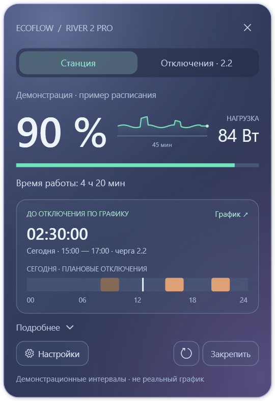
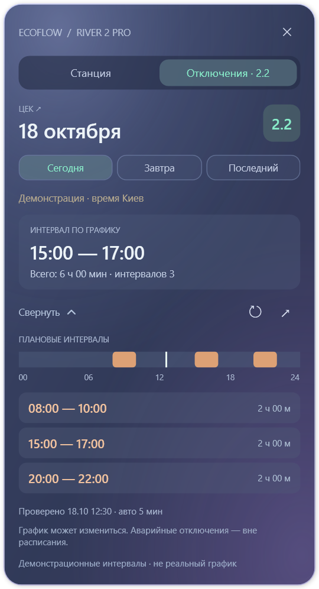

# EcoFlow Outage Widget

A Windows 11 tray widget that displays EcoFlow RIVER 2 Pro readings, estimated runtime, and the regional outage schedule. The interactive browser demo uses sample data.

[](https://github.com/yourkeey/ecoflow-outage-widget)
[](https://github.com/yourkeey/ecoflow-outage-widget)
[](https://github.com/yourkeey/ecoflow-outage-widget)
[](https://github.com/yourkeey/ecoflow-outage-widget)
[](https://yourkeey.github.io/ecoflow-outage-widget/)

> [!TIP]
> **Live interactive demo** · [yourkeey.github.io/ecoflow-outage-widget](https://yourkeey.github.io/ecoflow-outage-widget/)
>
> Runs in the browser with sample EcoFlow readings and outage intervals for queue 2.2 in Kyiv time. Click the mini chart for 45 minutes of load history and use **Отключения** (Outages) to browse the schedule. No credentials or physical hardware needed.

## Screenshots

<table>
  <thead>
    <tr>
      <th align="center">Station</th>
      <th align="center">Outage schedule</th>
    </tr>
  </thead>
  <tbody>
    <tr>
      <td align="center" valign="top">
        <a href="docs/screenshot.png">
          
        </a>
      </td>
      <td align="center" valign="top">
        <a href="docs/outage-schedule.png">
          
        </a>
      </td>
    </tr>
    <tr>
      <td align="center">Charge, load history, and outage countdown</td>
      <td align="center">Daily timeline and individual outage windows</td>
    </tr>
  </tbody>
</table>

Both screens use sample data.

---

## Architecture

| Component | Stack | Data and Responsibilities |
| --- | --- | --- |
| **Windows Tray Widget** | Windows PowerShell 5.1, WPF/XAML, optional C# launcher | Station charge %, wattage, 45-minute rolling load history, outage countdowns, and Windows native toast notifications |
| **Desktop Integrations** | PowerShell HTTPS & Python 3 standard library | EcoFlow developer API (readings), optional EcoFlow app private API (station controls), and CEK public outage parser (queue 2.2 in Kyiv time) |
| **Interactive Web Demo** | HTML5, CSS3, JavaScript (Canvas) | Browser-based simulator advancing state at 1 simulated minute per second |

---

## Quick Start on Windows

1. **Prerequisites:** Python 3 on `PATH` (used for outage schedule parsing and app-account mode).
2. **Launch the Widget:**
   ```powershell
   powershell.exe -NoProfile -STA -ExecutionPolicy Bypass -File .\widget.ps1
   ```
3. **Configure Connection:**
   Use the GUI dialog to select your region and enter station serial + credentials. Windows encrypts passwords and API keys via DPAPI in `connection.xml`.
   *(Optional `.env` mode supported via `.env.example`).*
4. **Build Desktop Launcher (Optional):**
   ```powershell
   powershell.exe -NoProfile -ExecutionPolicy Bypass -File .\build-launcher.ps1
   ```
   Generates a standalone `EcoFlow Widget.exe` for seamless background startup.

---

## Verification & Tests

```powershell
# Run Python API & schedule parser tests
python -m unittest discover

# Run PowerShell WPF widget test suite
Get-ChildItem -Filter 'test_*.ps1' | ForEach-Object {
    powershell.exe -NoProfile -STA -ExecutionPolicy Bypass -File $_.FullName
    if ($LASTEXITCODE -ne 0) { throw "Failed: $($_.Name)" }
}
powershell.exe -NoProfile -STA -ExecutionPolicy Bypass -File .\widget.ps1 -Check

# Verify interactive web demo simulation
node --test tests/demo.test.cjs
```

---

## GitHub Pages Deployment

The repository includes a GitHub Actions workflow (`.github/workflows/pages.yml`) that verifies demo tests on every push to `main` and publishes `demo/` to GitHub Pages automatically.
